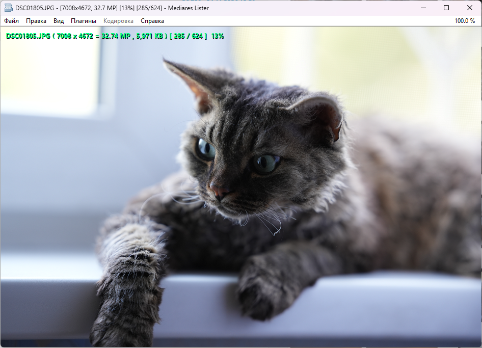
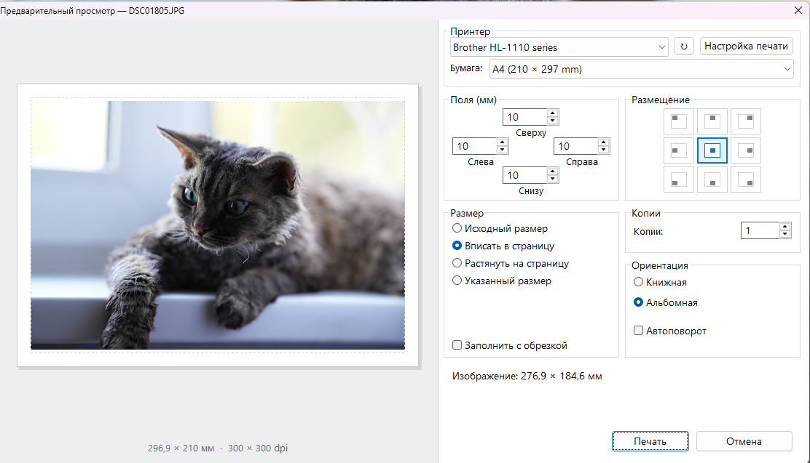
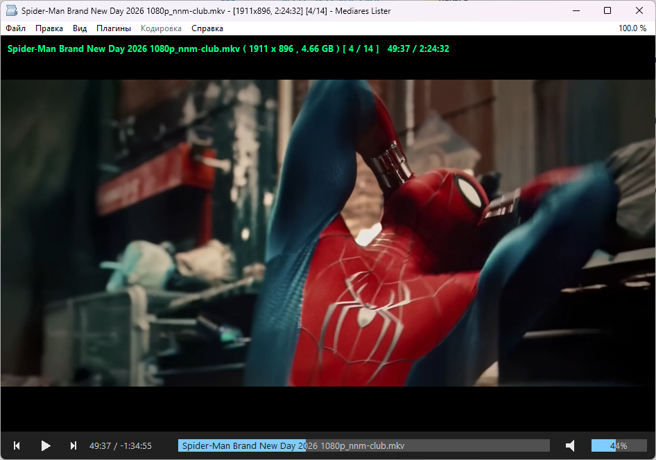
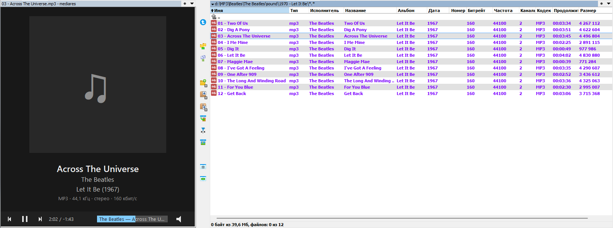
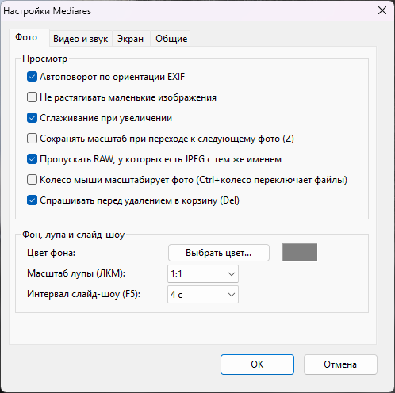
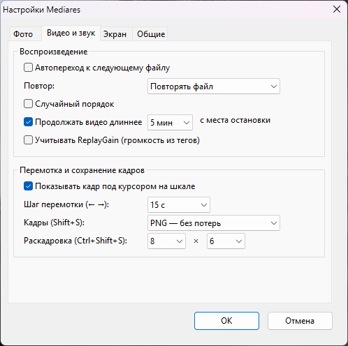
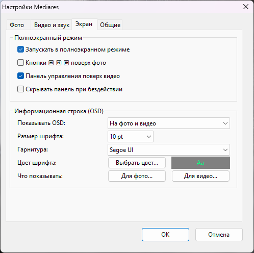
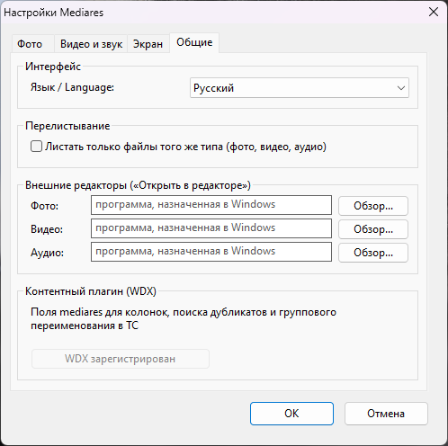

# Mediares for Total Commander

[Русский](README.md) | **English**

[](https://www.microsoft.com/windows)
[](https://www.ghisler.com/)
[](https://github.com/tatarinovs/mediares_wlx/releases/latest)
[](https://www.rust-lang.org/)
[](LICENSE)

Mediares opens photos, video and audio with **F3**, displays metadata in Total Commander columns and helps find duplicates.

Two versions are available:

- **WLX + WDX** — viewer and content plugin in a single file, `mediares.wlx64`.
- **WDX** — metadata and duplicate search only, without the viewer (`mediares.wdx64`).

## Contents

- [System requirements](#system-requirements)
- [Installation](#installation)
- [Viewer](#viewer)
- [Keyboard shortcuts](#keyboard-shortcuts)
- [Metadata and columns](#metadata-and-columns)
- [Ready-made column sets](#ready-made-column-sets)
- [Duplicate search](#duplicate-search)
- [Settings](#settings)
- [Building](#building)
- [License](#license)

## System requirements

- Windows 10 (1607) or later, 64-bit. SVG requires Windows 10 (1703) or later.
- 64-bit Total Commander.
- Windows N / KN requires the **Media Feature Pack**.

HEIC, AVIF and JPEG XL may require codec extensions from Microsoft Store or [libmpv](#additional-codecs-libmpv).

## Installation

1. Download an archive from [Releases](https://github.com/tatarinovs/mediares_wlx/releases/latest): `mediares-wlx-*.zip` for the viewer or `mediares-wdx-*.zip` for content features only.
2. Open the archive in Total Commander and confirm installation.
3. Select a media file and press **F3** to view it.

In the WLX version, content features need separate registration: open a media file with F3, press **S**, click **“Register WDX”** and restart Total Commander.

You can also register them manually: **Configuration → Options → Plugins → Content plugins → Configure → Add**. Select “All files” and choose the installed `mediares.wlx64`.

## Viewer

The viewer (**F3** / **Ctrl+Q**) also provides thumbnails for Total Commander (photos, video frames or audio cover art) and supports Windows shortcuts (`.lnk`).

### Photos



Supports JPEG, PNG, GIF, WebP, BMP, ICO, TGA, HDR, TIFF, JPEG XR, DDS, PSD/PSB and RAW from popular cameras. RAW files use their embedded JPEG preview; PSD/PSB files use the saved composite image. All pages of multipage TIFF files are available.

HEIC/HEIF, AVIF and JPEG XL open when the corresponding codecs are available. SVG/SVGZ are supported without text, filters or masks.

Features:

- Zoom, magnifier, rotation, two-photo comparison and slideshow.
- EXIF display and shooting location on a map.
- Save as JPEG/PNG, copy, print and open in an external editor.
- Print multipage TIFFs: all pages or selected numbers and ranges (e.g. `1-3, 5`), with page navigation in the preview.
- Lossless JPEG rotation and metadata removal.
- Skip RAW files when a matching JPEG exists.



### Video and audio



**Video:** MP4, MKV, AVI, MOV, WMV, WebM, M4V, 3GP, FLV, TS, MTS, MPEG, VOB and other formats when codecs are available.

**Audio:** MP3, MP2, FLAC, WAV, OGG, M4A/M4B, AAC, AIFF, CAF, MKA, WMA, Opus and AC3. Displays tags, cover art and lyrics when present in the file.



Features:

- Playlist from the current folder or an M3U/M3U8 file, repeat and shuffle.
- Seeking, frame stepping, video playback speed and audio track selection.
- Video timeline previews, chapters and A–B repeat.
- Save a frame or create a contact sheet.
- Resume video from the last position.
- Gapless audio between compatible tracks and ReplayGain volume adjustment.

### Windows shortcuts (.lnk)

Pressing **F3** or **Ctrl+Q** on a Windows shortcut plays or displays its target media file. Files and shortcuts are browsed in filename order within the shortcut's folder; shortcuts are also supported in M3U/M3U8 playlists. Thumbnails come from the target file, saved rotations update the original file, and **Del** moves the shortcut itself to the Recycle Bin.

### Additional codecs: libmpv

For broader format support, place a 64-bit **`libmpv-2.dll`** next to the plugin or `totalcmd64.exe` and restart Total Commander. The library is not included.

Download it from [shinchiro releases](https://github.com/shinchiro/mpv-winbuild-cmake/releases) — archive **`mpv-dev-x86_64-<date>.7z`** — or [SourceForge](https://sourceforge.net/projects/mpv-player-windows/files/libmpv/). The `x86_64-v3` variant requires Intel Haswell / AMD Excavator or later.

## Keyboard shortcuts

### General

| Action | Keys |
|---|---|
| Next / previous file | PgDn / PgUp, N / P, Space for photos; Backspace — previous |
| Fullscreen | Enter, F, F11 or double-click; Esc — exit |
| On-screen information (OSD) | O or I |
| Settings | S |
| Copy image, frame or cover art | Ctrl+C |
| Print preview and printing | Ctrl+P |
| Open in editor / show in folder | F4 / Ctrl+Enter |
| Move to Recycle Bin | Del |

### Photos

| Action | Keys / mouse |
|---|---|
| Zoom | + / −, Ctrl+wheel |
| 100% / fit to window | Ctrl+1 / Ctrl+0 (fit: also * and / on numpad) |
| 200% / 300% | Ctrl+2 / Ctrl+3 |
| Pan a zoomed photo | Arrow keys or drag |
| Magnifier in fit mode | Hold the left mouse button |
| TIFF pages | ← / →; when zoomed — Ctrl+PgUp / Ctrl+PgDn |
| Rotate left / right | L / R |
| Save JPEG rotation losslessly | Ctrl+R |
| Keep zoom when browsing | Z |
| Compare two photos | C; press again to exit |
| Slideshow | F5 |
| EXIF / shooting location on map | E / G |
| Save as JPEG or PNG | Ctrl+S |

By default, the mouse wheel browses photos and Ctrl+wheel zooms. You can swap this behavior in settings. In multipage TIFF files, the wheel browses pages first.

### Video and audio

| Action | Keys / mouse |
|---|---|
| Pause / play | Space, K, click video or cover art |
| Seek | ← / → or playback timeline |
| Total / remaining time | Click time counter on transport bar |
| Next / previous keyframe; ±1 s in audio | ↑ / ↓ |
| Previous / next frame | , / .; forward only for MPG/MPEG/VOB |
| Video speed / reset | [ / ] / \ |
| Volume / mute | + / −, Ctrl+wheel / M |
| Save frame / create contact sheet | Shift+S / Ctrl+Shift+S |
| A–B repeat: start, end, disable | Press A in sequence |
| Next audio track | B |
| Lyrics / cover art | Y |

## Metadata and columns

Both versions provide fields in the **`mediares`** group for columns, tooltips, search and multi-rename.

| Type | Available information |
|---|---|
| Photos | Dimensions, aspect ratio, sharpness, camera, lens, shooting date, exposure, aperture, ISO, GPS |
| Video | Duration, dimensions, frame rate, codecs, bitrate, HDR, rotation, audio track and tags |
| Audio | Artist, title, album, year, genre, track number, duration, codec and audio properties |

Video dimensions and duration are read from metadata without decoding frames. Use `Audio_Length` for a normal audio duration column (`Audio_Duration_Sec` measures the decoded stream). For the full field list, see the [user guide](docs/readme_eng.txt).

### Ready-made column sets

Three sets for **Show → Custom columns mode → Configure custom columns → New**. Paste the lines into `Headers` and `Contents` in the set editor, or add them directly to `wincmd.ini` (in sections such as `[Columns0]`, `[Columns1]`, with `Headers0`/`Contents0`, etc.; adjust the numbers to match your sets).

`mediares` is the plugin's registered name in Total Commander (by default, its filename); if you chose another name during installation, replace the prefix. `tc.size` is a built-in Total Commander field.

**Photos** (EXIF):

```
Headers=Dimensions\nMake\nModel\nExposure\nAperture\nISO\nGPS Latitude\nGPS Longitude\nDate taken\nSize
Contents=[=mediares.Image_Dimensions]\n[=mediares.Photo_Make]\n[=mediares.Photo_Model]\n[=mediares.Photo_Exposure]\n[=mediares.Photo_FNumber]\n[=mediares.Photo_ISO]\n[=mediares.Photo_GPS_Latitude]\n[=mediares.Photo_GPS_Longitude]\n[=mediares.Photo_Date_Taken]\n[=tc.size]
```

**Audio** (tags and stream properties):

```
Headers=Artist\nTitle\nAlbum\nYear\nGenre\nTrack\nBitrate\nSample rate\nChannels\nCodec\nDuration\nSize
Contents=[=mediares.Audio_Artist]\n[=mediares.Audio_Title]\n[=mediares.Audio_Album]\n[=mediares.Audio_Year]\n[=mediares.Audio_Genre]\n[=mediares.Audio_Track]\n[=mediares.Audio_Bitrate_kbps]\n[=mediares.Audio_Sample_Rate_Hz]\n[=mediares.Audio_Channels]\n[=mediares.Audio_Codec]\n[=mediares.Audio_Length]\n[=tc.size]
```

**Video** (stream properties):

```
Headers=Title\nWidth\nHeight\nBitrate\nFrame rate\nCodec\nDuration\nSize
Contents=[=mediares.Video_Title]\n[=mediares.Video_Width]\n[=mediares.Video_Height]\n[=mediares.Video_Bitrate_kbps]\n[=mediares.Video_Frame_Rate]\n[=mediares.Video_Codec]\n[=mediares.Video_Length]\n[=tc.size]
```

## Duplicate search

In Total Commander's duplicate search, choose comparison by plugin fields and select a suitable field:

| Field | Use |
|---|---|
| `Image_pHash` | Re-saved and resized photo copies |
| `Image_dHash` | Photo copies with minor changes |
| `Image_CoarseHash` | Photos with contrast changes, slight cropping, RAW + JPEG pairs; more prone to false matches |
| `Video_Fingerprint` | Video copies and container changes without re-encoding |
| `Video_dHash_Mid` | Compare videos by a frame in the middle |
| `Audio_Fingerprint` | Audio copies with a different bitrate or codec (full scan; `< 3` s falls back to PCM hash) |
| `Audio_Fast_Fingerprint` | Fast audio fingerprint: on tracks `> 75` s, seeks to edges and three windows |
| `Audio_PCM_Hash` | Identical decoded audio, such as WAV and FLAC |
| `Audio_Artist_Title` | Match artist and title tags |

Behavior notes:

- Total Commander compares values exactly, so photo rotation, cropping, video edits or different audio mastering can change the result and leave some modified copies unmatched.
- `Audio_Fingerprint` and `Audio_PCM_Hash` read the entire file in one pass; `Audio_Fast_Fingerprint` skips the bulk of tracks longer than 75 s and decodes only short slices.
- Audio hashes and fingerprints are withheld on a decoding error or detected truncation.

**Check matches before deleting files.**

## Settings

Press **S** in the viewer or choose **“Settings...”** from the context menu. Options include language, separating browsing by media type (photo, video, audio), background, zoom, slideshow, fullscreen, playback, external editors and on-screen information (OSD).

| Photos | Video and audio |
|:---:|:---:|
|  |  |
| **Display** | **General** |
|  |  |

The interface is available in Russian and English; additional translations can be added through `mediares_ui.lng`.

For a portable installation, place `mediares.ini` next to the plugin. Otherwise, Total Commander's plugin settings folder is used.

### Data storage and cache

- **Video resume positions:** stored in `%LOCALAPPDATA%\mediares\mediares.sqlite3` (up to 200 recent videos), separately from the clearable metadata cache.
- **Metadata and hash cache:** EXIF, tags, stream properties, dimensions, sharpness, hashes and fingerprints are cached in `%LOCALAPPDATA%\mediares\content-cache.sqlite3` (capped at 256 MiB / ~500,000 records, with background eviction of oldest entries). Values are reread when file size, modification time or algorithm version changes.
- **Cache management:** to clear it, close all TC instances and delete `content-cache.sqlite3`. For diagnostics, set `MEDIARES_CONTENT_CACHE=off` before starting TC (or specify an absolute path on a local drive).
- **Temporary files:** PNGs of copied frames and cover art in `%TEMP%\Mediares` are cleaned up on viewer startup or another copy once at least 24 hours old; the current clipboard image and files open in other apps are kept.

### Background prefetch (WDX)

- Hash, fingerprint and sharpness requests automatically prefetch neighboring files with the same extension in the current folder (subfolders are not traversed; metadata and duration are not prefetched).
- `Audio_Fingerprint` and `Audio_PCM_Hash` are computed and cached together in a single decoding pass; `Audio_Fast_Fingerprint` is computed independently. Requesting duration does not start hashing.
- The worker count is tuned automatically (up to 16, capped by available CPUs). You can override it in `mediares.ini` (`0` disables read-ahead, `1`–`16` sets a fixed worker count; restart TC after editing):

```ini
[Settings]
PrefetchThreads=4
```

## Building

Checks and builds require Rust and tools for the selected toolchain. Release script `build_release.bat` uses `stable-x86_64-pc-windows-gnu` (installed via rustup if missing); first add the `bin` directory from w64devkit, containing `dlltool.exe`, to `PATH`.

```powershell
cargo test --workspace --locked  # tests for the entire workspace
.\build_release.bat              # release DLLs and installation archives in dist/

# Internal and integration checks:
python scripts/test_content_cache.py --dll dist/mediares_wdx_only.wdx64
python scripts/test_prefetch.py --dll dist/mediares_wdx_only.wdx64
python scripts/test_content_cache.py --dll dist/mediares_wdx_only.wdx64 --viewer-dll dist/mediares.wlx64 --stress
cargo build -p mediares_combo --example lister_harness --locked
python scripts/test_save_as.py
```

## License

[MIT](LICENSE).
