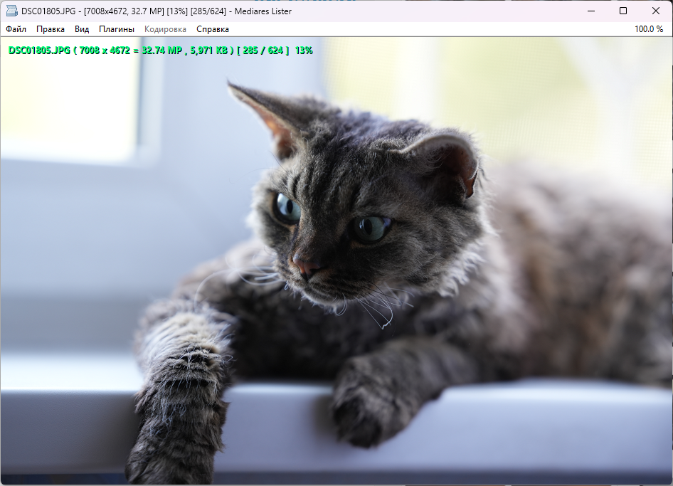
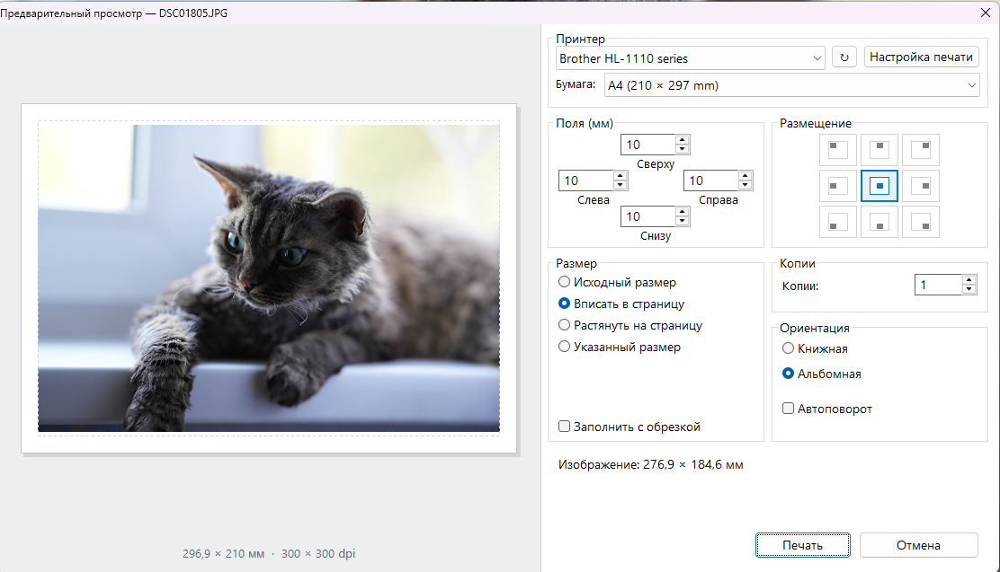
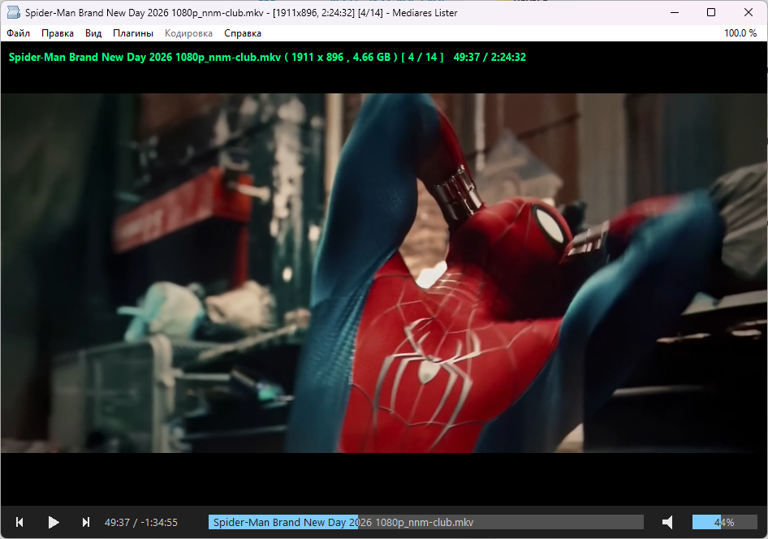
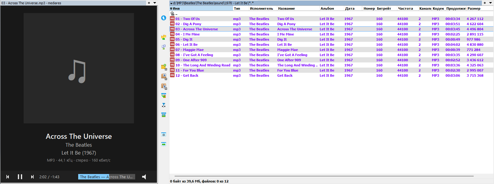
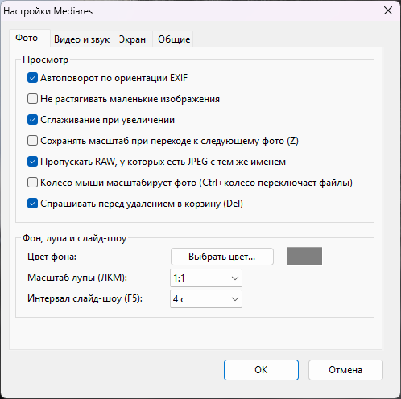
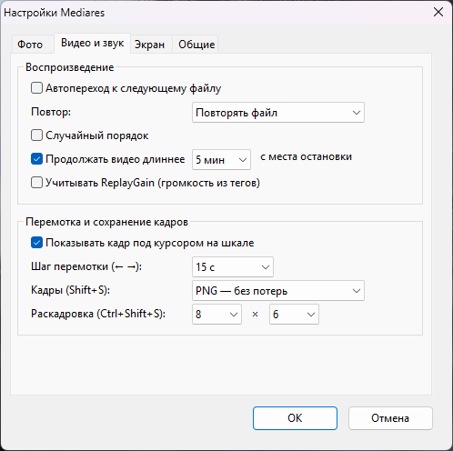
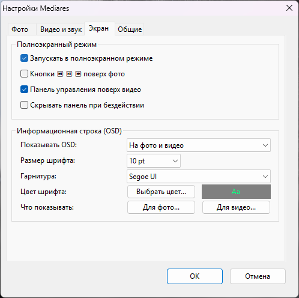
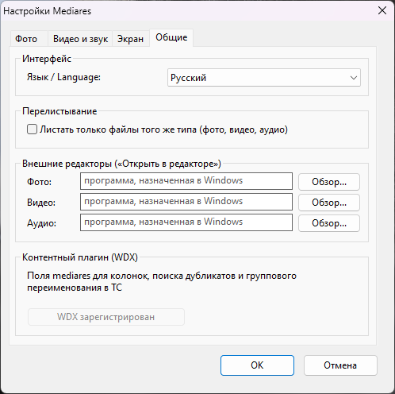

# Mediares для Total Commander

**Русский** | [English](README.en.md)

[](https://www.microsoft.com/windows)
[](https://www.ghisler.com/)
[](https://github.com/tatarinovs/mediares_wlx/releases/latest)
[](https://www.rust-lang.org/)
[](LICENSE)

Mediares открывает фото, видео и аудио по **F3**, показывает метаданные в колонках Total Commander и помогает искать дубликаты.

Доступны две версии:

- **WLX + WDX** — просмотрщик и контентный плагин в одном файле `mediares.wlx64`.
- **WDX** — только метаданные и поиск дубликатов, без просмотрщика (`mediares.wdx64`).

## Оглавление

- [Системные требования](#системные-требования)
- [Установка](#установка)
- [Просмотрщик](#просмотрщик)
- [Основные клавиши](#основные-клавиши)
- [Метаданные и колонки](#метаданные-и-колонки)
- [Готовые наборы колонок](#готовые-наборы-колонок)
- [Поиск дубликатов](#поиск-дубликатов)
- [Настройки](#настройки)
- [Сборка](#сборка)
- [Лицензия](#лицензия)

## Системные требования

- Windows 10 (1607) или новее, 64-битная. Для SVG — Windows 10 (1703) или новее.
- 64-битный Total Commander.
- В Windows N / KN необходимо установить **Media Feature Pack**.

Для HEIC, AVIF и JPEG XL могут понадобиться расширения кодеков из Microsoft Store или [libmpv](#дополнительные-кодеки-libmpv).

## Установка

1. Скачайте архив со страницы [Releases](https://github.com/tatarinovs/mediares_wlx/releases/latest): `mediares-wlx-*.zip` для просмотрщика или `mediares-wdx-*.zip` только для контентных функций.
2. Откройте архив в Total Commander и подтвердите установку.
3. Для просмотра выберите медиафайл и нажмите **F3**.

В версии WLX контентные функции подключаются отдельно: откройте медиафайл по F3, нажмите **S**, затем **«Зарегистрировать WDX»** и перезапустите Total Commander.

Можно подключить их вручную: **Конфигурация → Настройка → Плагины → Контентные плагины → Настроить → Добавить**. Выберите тип «Все файлы» и укажите установленный `mediares.wlx64`.

## Просмотрщик

Просмотрщик (**F3** / **Ctrl+Q**) также формирует миниатюры для режима эскизов Total Commander (фото, кадр видео или обложку аудио) и поддерживает ярлыки Windows (`.lnk`).

### Фото



Поддерживаются JPEG, PNG, GIF, WebP, BMP, ICO, TGA, HDR, TIFF, JPEG XR, DDS, PSD/PSB и RAW популярных камер. RAW показывается по встроенному JPEG-превью, PSD/PSB — по сохранённому композитному изображению. Доступны все страницы многостраничного TIFF.

HEIC/HEIF, AVIF и JPEG XL открываются при наличии соответствующих кодеков. SVG/SVGZ поддерживаются без текста, фильтров и масок.

Возможности:

- Масштабирование, лупа, поворот, сравнение двух фото и слайд-шоу.
- Просмотр EXIF и места съёмки на карте.
- Сохранение в JPEG/PNG, копирование, печать и открытие во внешнем редакторе.
- Печать многостраничных TIFF: все страницы или выбранные номера и диапазоны (например, `1-3, 5`), с перелистыванием предпросмотра.
- Поворот JPEG без потерь и очистка его метаданных.
- Пропуск RAW при наличии парного JPEG.



### Видео и аудио



**Видео:** MP4, MKV, AVI, MOV, WMV, WebM, M4V, 3GP, FLV, TS, MTS, MPEG, VOB и другие форматы при наличии кодеков.

**Аудио:** MP3, MP2, FLAC, WAV, OGG, M4A/M4B, AAC, AIFF, CAF, MKA, WMA, Opus и AC3. Показываются теги, обложка и текст песни, если он есть в файле.



Возможности:

- Плей-лист из текущей папки или файла M3U/M3U8, повтор и случайный порядок.
- Перемотка, покадровый просмотр, изменение скорости видео и выбор аудиодорожки.
- Превью на шкале видео, главы и повтор фрагмента A–B.
- Сохранение кадра и создание раскадровки.
- Продолжение видео с места остановки.
- Воспроизведение аудио без пауз между совместимыми треками и выравнивание громкости по ReplayGain.

### Ярлыки Windows (.lnk)

При открытии ярлыка по **F3** или **Ctrl+Q** Mediares воспроизводит целевой медиафайл. При листании ярлыки и файлы идут в порядке имён в папке ярлыка; ярлыки также поддерживаются в плей-листах M3U/M3U8. Миниатюра берётся из целевого файла, сохранение поворота применяется к оригиналу, а клавиша **Del** отправляет в корзину сам ярлык.

### Дополнительные кодеки: libmpv

Для расширенной поддержки форматов положите 64-битную **`libmpv-2.dll`** рядом с плагином или `totalcmd64.exe` и перезапустите Total Commander. Библиотека в комплект не входит.

Скачать её можно из [релизов shinchiro](https://github.com/shinchiro/mpv-winbuild-cmake/releases) — архив **`mpv-dev-x86_64-<дата>.7z`** — или с [SourceForge](https://sourceforge.net/projects/mpv-player-windows/files/libmpv/). Вариант `x86_64-v3` требует Intel Haswell / AMD Excavator или новее.

## Основные клавиши

### Общие

| Действие | Клавиши |
|---|---|
| Следующий / предыдущий файл | PgDn / PgUp, N / P, для фото — Пробел; Backspace — предыдущий |
| Полноэкранный режим | Enter, F, F11 или двойной клик; Esc — выход |
| Сведения поверх изображения (OSD) | O или I |
| Настройки | S |
| Копировать изображение, кадр или обложку | Ctrl+C |
| Предпросмотр и печать | Ctrl+P |
| Открыть в редакторе / показать в папке | F4 / Ctrl+Enter |
| Удалить в корзину | Del |

### Фото

| Действие | Клавиши / мышь |
|---|---|
| Масштаб | + / −, Ctrl+колесо |
| Масштаб 100 % / вписать в окно | Ctrl+1 / Ctrl+0 (вписать — также * и / на цифровом блоке) |
| Масштаб 200 % / 300 % | Ctrl+2 / Ctrl+3 |
| Перемещение увеличенного фото | Стрелки или перетаскивание |
| Лупа в режиме «вписать» | Удержание левой кнопки мыши |
| Страницы TIFF | ← / →; при увеличении — Ctrl+PgUp / Ctrl+PgDn |
| Поворот влево / вправо | L / R |
| Записать поворот в JPEG без потерь | Ctrl+R |
| Сохранять масштаб при листании | Z |
| Сравнение двух фото | C; повторное нажатие — выход |
| Слайд-шоу | F5 |
| EXIF / место съёмки на карте | E / G |
| Сохранить как JPEG или PNG | Ctrl+S |

Колесо мыши по умолчанию листает фото, Ctrl+колесо меняет масштаб. Это поведение можно поменять в настройках. В многостраничном TIFF колесо сначала листает страницы.

### Видео и аудио

| Действие | Клавиши / мышь |
|---|---|
| Пауза / воспроизведение | Пробел, K, клик по видео или обложке |
| Перемотка | ← / → или шкала воспроизведения |
| Общее / оставшееся время | Клик по счётчику времени на панели |
| Ключевой кадр вперёд / назад; в аудио — ±1 с | ↑ / ↓ |
| Кадр назад / вперёд | , / .; для MPG/MPEG/VOB — только вперёд |
| Скорость видео / сброс | [ / ] / \ |
| Громкость / без звука | + / −, Ctrl+колесо / M |
| Сохранить кадр / создать раскадровку | Shift+S / Ctrl+Shift+S |
| Повтор A–B: начало, конец, отключение | A — последовательно |
| Следующая аудиодорожка | B |
| Текст песни / обложка | Y |

## Метаданные и колонки

Обе версии предоставляют поля группы **`mediares`** для колонок, подсказок, поиска и группового переименования.

| Тип | Доступные сведения |
|---|---|
| Фото | Размеры, пропорции, резкость, камера, объектив, дата съёмки, выдержка, диафрагма, ISO, GPS |
| Видео | Длительность, размеры, частота кадров, кодеки, битрейт, HDR, поворот, звуковая дорожка и теги |
| Аудио | Исполнитель, название, альбом, год, жанр, номер трека, длительность, кодек и параметры звука |

Размеры и длительность видео читаются из метаданных без анализа кадров. Для колонки длительности аудио используйте `Audio_Length` (`Audio_Duration_Sec` измеряет декодированный поток). Полный список полей — в [пользовательской инструкции](docs/readme_rus.txt).

### Готовые наборы колонок

Три набора для **Вид → Настройка колонок панели → Новый**: вставьте строки в поля `Headers` и `Contents` в диалоге редактирования или напрямую в `wincmd.ini` (секции `[Columns0]`, `[Columns1]`… с ключами `Headers0`/`Contents0` и т. д. — номер подставьте по своим наборам).

`mediares` — имя плагина в Total Commander (по умолчанию совпадает с именем файла); если при установке выбрано другое, замените префикс. `tc.size` — стандартное поле TC.

**Фото** (EXIF):

```
Headers=Разрешение\nКамера\nМодель\nВыдержка\nДиафрагма\nISO\nGPS Широта\nGPS Долгота\nДата снимка\nРазмер
Contents=[=mediares.Image_Dimensions]\n[=mediares.Photo_Make]\n[=mediares.Photo_Model]\n[=mediares.Photo_Exposure]\n[=mediares.Photo_FNumber]\n[=mediares.Photo_ISO]\n[=mediares.Photo_GPS_Latitude]\n[=mediares.Photo_GPS_Longitude]\n[=mediares.Photo_Date_Taken]\n[=tc.size]
```

**Аудио** (теги и параметры потока):

```
Headers=Исполнитель\nНазвание\nАльбом\nДата\nЖанр\nНомер\nБитрейт\nЧастота\nКаналы\nКодек\nПродолжительность\nРазмер
Contents=[=mediares.Audio_Artist]\n[=mediares.Audio_Title]\n[=mediares.Audio_Album]\n[=mediares.Audio_Year]\n[=mediares.Audio_Genre]\n[=mediares.Audio_Track]\n[=mediares.Audio_Bitrate_kbps]\n[=mediares.Audio_Sample_Rate_Hz]\n[=mediares.Audio_Channels]\n[=mediares.Audio_Codec]\n[=mediares.Audio_Length]\n[=tc.size]
```

**Видео** (параметры потока):

```
Headers=Название\nШирина\nВысота\nБитрейт\nКадры\nКодек\nПродолжительность\nРазмер
Contents=[=mediares.Video_Title]\n[=mediares.Video_Width]\n[=mediares.Video_Height]\n[=mediares.Video_Bitrate_kbps]\n[=mediares.Video_Frame_Rate]\n[=mediares.Video_Codec]\n[=mediares.Video_Length]\n[=tc.size]
```

## Поиск дубликатов

В поиске дубликатов Total Commander выберите сравнение по полям плагина и укажите подходящее поле:

| Поле | Для чего подходит |
|---|---|
| `Image_pHash` | Пересохранённые и уменьшенные копии фото |
| `Image_dHash` | Копии фото с небольшими изменениями |
| `Image_CoarseHash` | Фото с изменённым контрастом, небольшой обрезкой, пары RAW + JPEG; чаще даёт ложные совпадения |
| `Video_Fingerprint` | Копии видео и смена контейнера без перекодирования |
| `Video_dHash_Mid` | Сравнение видео по кадру в середине |
| `Audio_Fingerprint` | Копии аудио с другим битрейтом или кодеком (полное чтение, для записей < 3 с — PCM-хеш) |
| `Audio_Fast_Fingerprint` | Быстрый отпечаток аудио: для треков длиннее 75 с читает только края и три фрагмента |
| `Audio_PCM_Hash` | Одинаковый декодированный звук, например WAV и FLAC |
| `Audio_Artist_Title` | Совпадение исполнителя и названия по тегам |

Особенности работы:

- Total Commander сравнивает значения точно, поэтому поворот, обрезка, перемонтаж видео или другой мастеринг аудио могут изменить результат — часть изменённых копий может остаться ненайденной.
- `Audio_Fingerprint` и `Audio_PCM_Hash` читают весь файл за один проход; `Audio_Fast_Fingerprint` на треках длиннее 75 с пропускает середину и декодирует только фрагменты.
- При ошибке декодирования или обнаружении обрыва потока хеши и отпечаток аудио не выдаются.

**Перед удалением проверяйте найденные совпадения.**

## Настройки

Нажмите **S** в просмотрщике или выберите **«Настройки...»** в контекстном меню. Здесь задаются язык, разделение перелистывания по типам файлов (фото, видео, аудио), фон, масштабирование, слайд-шоу, полноэкранный режим, воспроизведение, внешние редакторы и сведения поверх изображения (OSD).

| Фото | Видео и аудио |
|:---:|:---:|
|  |  |
| **Экран** | **Общие** |
|  |  |

Интерфейс доступен на русском и английском; дополнительные переводы подключаются через `mediares_ui.lng`.

Для портативной установки положите `mediares.ini` рядом с плагином. Иначе используется каталог настроек плагинов Total Commander.

### Хранение данных и кэш

- **Позиции просмотра видео:** сохраняются в `%LOCALAPPDATA%\mediares\mediares.sqlite3` (до 200 последних файлов), отдельно от сбрасываемого кэша.
- **Кэш метаданных и хешей:** EXIF, теги, параметры потоков, размеры, резкость, хеши и отпечатки кэшируются в `%LOCALAPPDATA%\mediares\content-cache.sqlite3` (лимит базы — 256 МиБ или около 500 тысяч записей, старые записи удаляются в фоне). При изменении размера, даты файла или версии алгоритма данные перечитываются.
- **Управление кэшем:** для очистки закройте все окна Total Commander и удалите `content-cache.sqlite3`. Для диагностики задайте перед запуском TC переменную среды `MEDIARES_CONTENT_CACHE=off` (отключает кэш) или укажите в ней абсолютный путь к файлу базы на локальном диске.
- **Временные файлы:** PNG-копии кадров и обложек в `%TEMP%\Mediares` удаляются автоматически (при запуске просмотрщика или следующем копировании) не раньше чем через сутки. Текущий файл буфера обмена и файлы, открытые другими программами, не затрагиваются.

### Фоновый прогрев (WDX)

- Запросы хешей, отпечатков и резкости автоматически запускают фоновый прогрев соседних файлов с тем же расширением в текущей папке (подпапки не обходятся; метаданные и длительность не прогреваются).
- `Audio_Fingerprint` и `Audio_PCM_Hash` рассчитываются и кэшируются вместе за один проход, `Audio_Fast_Fingerprint` — отдельно. Запрос длительности не запускает хеширование.
- Число рабочих потоков подбирается автоматически (до 16, в пределах доступных ядер CPU). При необходимости количество потоков можно задать вручную в `mediares.ini` (`0` отключает прогрев, `1`–`16` задают фиксированное число; после изменения перезапустите TC):

```ini
[Settings]
PrefetchThreads=4
```

## Сборка

Для проверок и сборки нужен Rust с инструментами выбранного toolchain. Релизный `build_release.bat` использует `stable-x86_64-pc-windows-gnu` (устанавливается через rustup при отсутствии); заранее добавьте каталог `bin` из w64devkit (с `dlltool.exe`) в `PATH`.

```powershell
cargo test --workspace --locked  # тесты всего workspace
.\build_release.bat              # релизные DLL и установочные архивы в dist/

# Внутренние и интеграционные проверки:
python scripts/test_content_cache.py --dll dist/mediares_wdx_only.wdx64
python scripts/test_prefetch.py --dll dist/mediares_wdx_only.wdx64
python scripts/test_content_cache.py --dll dist/mediares_wdx_only.wdx64 --viewer-dll dist/mediares.wlx64 --stress
cargo build -p mediares_combo --example lister_harness --locked
python scripts/test_save_as.py
```

## Лицензия

[MIT](LICENSE).
